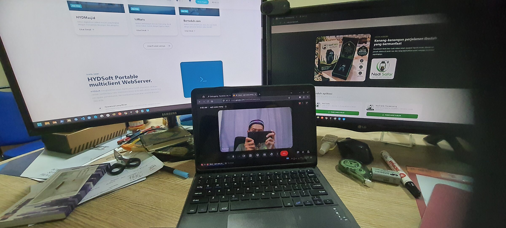
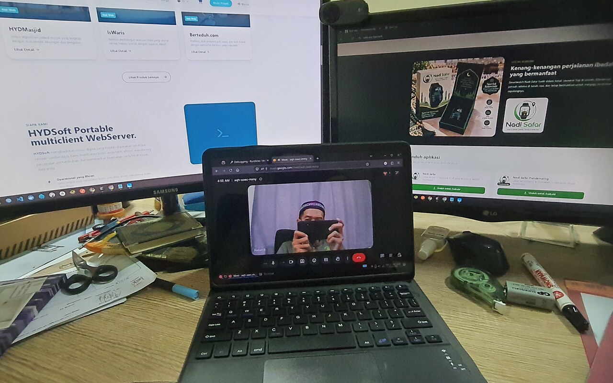
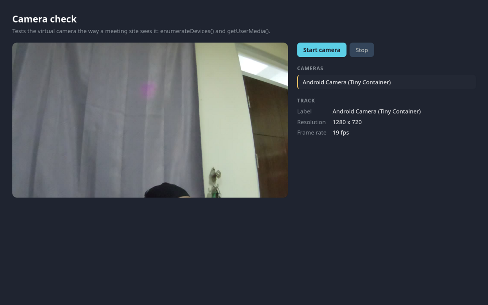

<p align="center">
  
</p>

<p align="center"><i>Google Meet running in Firefox inside Tiny Computer on a Galaxy Tab S8, with video from the tablet's camera.</i></p>

<p align="center">
  
</p>

<h1 align="center">Tiny Container Camera</h1>

<p align="center">
  Use your Android phone/tablet camera as a webcam on <b>any website</b>
  (Microsoft Teams, Google Meet, Zoom web, ...) in Firefox running inside
  <a href="https://github.com/Cateners/tiny_container">Tiny Computer / tiny_container</a>
  or any other proot environment. No extra Android app, no root.
</p>

## Firefox Add-on

Running Linux on Android with Tiny Computer, Termux or another proot container
is great for coding, until you need to join a video call with your team:
Android does not let apps inside the container use the camera.

Tiny Container Camera fixes that. It reads the device camera over ADB
(wireless debugging) and turns it into a webcam that every website can use.

**Features**

- Virtual camera named "Android Camera (Tiny Container)" on every HTTPS site:
  Microsoft Teams, Google Meet, Zoom, Jitsi and others.
- No extra Android app: the camera is read over ADB with
  [scrcpy](https://github.com/Genymobile/scrcpy)'s server, started and stopped
  automatically when a site needs the camera.
- Asks before a site can use the camera, like Firefox does for a real webcam.
  Decisions are remembered per site and can be changed on the options page.
- The device camera turns off by itself shortly after the last page stops
  using it.
- Toolbar button to connect or pair ADB and switch between the front and back
  camera.
- Also works with any MJPEG stream, such as the IP Webcam app.
- Your microphone keeps working as usual.
- No root, no kernel modules, no v4l2loopback.
- No data collection. Video only travels from your device to the page that
  asked for it.

**Quick start**

1. Enable **Wireless debugging** on Android and connect ADB from the container.
2. Run `sh camera-bridge/install.sh` from this repository (once).
3. Install the add-on and click **Save and grant access** on the options page.
4. Choose **Android Camera (Tiny Container)** in your meeting settings.

**Video calls in proot**: on Android 11 and newer, WebRTC calls from Firefox
inside proot fail to connect because Android blocks netlink sockets. This
repository includes a small fix, [`webrtc-fix`](#4-webrtc-fix), that makes
calls work.

<p align="center">
  
  
</p>

## Tested on

| | |
|---|---|
| Device | Samsung Galaxy Tab S8 5G (SM-X706B) |
| Chipset | Qualcomm Snapdragon 8 Gen 1 (SM8450) |
| RAM | 8 GB |
| OS | Android 16, One UI 8.0 (not rooted) |
| Container | Tiny Computer (`com.fct.tc4`), Debian in proot |
| Browser | Firefox ESR 153.5 |
| Camera source | ADB + scrcpy 3.3.4 (1280x720, 30 fps); IP Webcam (`com.pas.webcam`) |
| Sites | Google Meet (call), webcamtoy.com |

## How it works

Inside proot, Android's `/dev/video*` devices are not accessible without root,
and `v4l2loopback` cannot be installed because kernel modules cannot be loaded.
So the camera cannot be passed through as a regular V4L2 device (this includes
`scrcpy --v4l2-sink`).

ADB still can reach the camera: `camera-bridge/tcc_camera.py` runs
scrcpy-server on the device with the camera as video source, decodes the
H.264 stream with ffmpeg and serves MJPEG on `http://127.0.0.1:8765/video`.
The extension reads that stream and exposes it to web pages as a virtual camera
through `getUserMedia()`. It starts the bridge through Firefox native messaging
when a page asks for the camera, and stops it 15 seconds after the last page
lets go of it.

```
camera ─▶ scrcpy-server ─adb─▶ ffmpeg ─MJPEG─▶ background.js ─▶ isolated.js ─▶ main.js
          (on the device)       (tcc_camera.py)                                 canvas.captureStream()
                                                                                → getUserMedia() on the page
```

Video calls need one more fix. Android 11+ forbids apps from using netlink
sockets, which Firefox uses to list local network addresses for WebRTC. With
no addresses, Firefox gathers no ICE candidates and every call fails ("Sorry,
we encountered a problem joining this video call."). `webrtc-fix/` is a small
`LD_PRELOAD` library that answers those netlink requests using ioctls that
Android still allows.

## Setup

### 1. ADB

```sh
sudo apt install adb scrcpy ffmpeg
```

On Android, open **Settings → Developer options → Wireless debugging** and turn
it on. The first time, tap **Pair device with pairing code** and pair, either
from the extension's toolbar button (*Pair a new device*) or with:

```sh
adb pair HOST:PAIRING_PORT CODE
```

Then connect with the toolbar button (*Connect*) or with
`adb connect HOST:PORT`, using the port shown on the Wireless debugging screen.
With the address left empty, *Connect* tries the last address that worked,
then looks for the port by itself; that search can take up to 2 minutes inside
proot, so typing the address is faster after wireless debugging was turned off
and on.

### 2. Camera bridge

```sh
sh camera-bridge/install.sh
```

This copies the bridge to `~/.local/lib/tiny-container-camera/camera-bridge/`
and registers it with Firefox (`~/.mozilla/native-messaging-hosts/`). Restart
Firefox afterwards. To undo: `sh camera-bridge/install.sh --uninstall`.

The bridge can also run on its own, for example to use it with other programs:

```sh
python3 camera-bridge/tcc_camera.py --facing back --size 1280 --fps 30
```

### 3. Extension

Download the signed `.xpi` from the
[Releases](https://github.com/CreatorB/tiny-container-camera/releases) page,
then in Firefox (128+) open `about:addons` → gear icon →
*Install Add-on From File…*

The options page opens after installing: click **Save and grant access** to
let the extension read the stream from `127.0.0.1`.

### 4. WebRTC fix

Needed for video calls (Teams, Meet, ...); not needed for camera-only sites.
Requires `gcc` (`sudo apt install gcc`).

```sh
sh webrtc-fix/install.sh
```

This builds the library into `~/.local/lib/tiny-container-camera/` and makes
Firefox ESR start with it (app menu, links opened from other apps, and the
`firefox-esr` command). Close every Firefox window and start it again.
To undo: `sh webrtc-fix/install.sh --uninstall`.

To try it once without installing:

```sh
gcc -O2 -shared -fPIC -o /tmp/libnetlink_shim.so webrtc-fix/netlink_shim.c -ldl -lpthread
LD_PRELOAD=/tmp/libnetlink_shim.so firefox-esr
```

### 5. Join a meeting

Pick the **Android Camera (Tiny Container)** camera in the meeting settings.
The first time a site asks for the camera, the extension opens a small window:
choose **Allow**. The first frame takes a few seconds while the camera starts
on the device.

## Privacy

Because the virtual camera bypasses Firefox's own camera prompt, the extension
asks for itself: a site gets no video, and the device camera is not turned on,
until you allow that site. The check runs in the extension's background
script against the address Firefox reports for the page, so a page cannot
grant itself access. Allowed and blocked sites are listed on the options page.

The camera bridge stops 15 seconds after the last page releases the camera,
and in any case after 30 seconds without viewers (even if Firefox was closed).

## Using IP Webcam instead of ADB

If you prefer an Android app, install **IP Webcam** (`com.pas.webcam`), tap
**Start server**, then set the stream URL on the extension's options page to
`http://127.0.0.1:8080/video`. Steps 1 and 2 above are not needed in that case.

Make sure nothing else in the container listens on port 8080 (a local web
server, for example), or change the IP Webcam port.

## Troubleshooting

### The site says the camera is blocked

You chose **Block** for that site earlier. Open the extension options in
`about:addons`, remove the site under **Sites**, and reload the page.

### The camera shows "No access to 127.0.0.1"

Open the extension options in `about:addons` and click
**Save and grant access**, then reload the page.

### The camera shows "Camera bridge not installed"

Run `sh camera-bridge/install.sh` and restart Firefox.

### The camera shows "no ADB device connected"

Connect ADB from the toolbar button or with `adb connect HOST:PORT`. The
Wireless debugging port changes every time it is turned off and on.

### Camera bridge log

The bridge writes its log to `~/.cache/tiny-container-camera/bridge.log`.
Run it by hand with `--verbose` to see the frame rate every 5 seconds:

```sh
python3 camera-bridge/tcc_camera.py --verbose
```

### Samsung: IP Webcam stops in the background

One UI freezes background apps ("Freecess"), so the IP Webcam server stops as
soon as you switch back to Tiny Computer. Exclude it from battery optimization
(Settings → Battery → Background usage limits → *Never sleeping apps*), or via
ADB:

```sh
adb shell dumpsys deviceidle whitelist +com.pas.webcam
adb shell cmd appops set com.pas.webcam RUN_ANY_IN_BACKGROUND allow
```

### Checking the WebRTC fix

```sh
LD_PRELOAD=~/.local/lib/tiny-container-camera/libnetlink_shim.so ip -4 addr
```

should list your interfaces (without the library it fails with
`Cannot bind netlink socket: Permission denied`). Set `NETLINK_SHIM_DEBUG=1`
to log the netlink requests the library answers.

## Development

To try code changes without signing: `about:debugging` → *This Firefox* →
*Load Temporary Add-on…* → select `extension/manifest.json`.
Temporary add-ons are removed when Firefox closes.

`sh build.sh` builds `dist/tiny-container-camera.xpi` (unsigned). To sign it,
use [`web-ext sign`](https://extensionworkshop.com/documentation/develop/web-ext-command-reference/#web-ext-sign).
The addons.mozilla.org listing text is kept in `amo/metadata.json`.

`sh build.sh --debug` also writes `dist/debug-extension/`, which sends every
`getUserMedia`/`enumerateDevices` call made by pages to
`python3 tools/log_server.py` (written to `tcc.log`).

### Testing without a phone

```sh
python3 tools/mock_mjpeg.py --port 8765 image1.jpg image2.jpg
```

Then open `http://127.0.0.1:8765/tcc-test.html` and click **Start camera**.

## Limitations

- Firefox 128+ only (uses `world: "MAIN"` content scripts).
- The ADB camera source needs Android 12+.
- Frames are decoded inside proot, so lower resolutions run smoother.
- The WebRTC fix reports IPv4 addresses only.
- Sites still ask for microphone permission as usual. No camera permission
  prompt appears because the camera is virtual.

## License

MIT, see [LICENSE](LICENSE).
